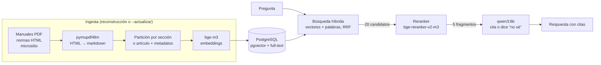

# RArca

Asistente que responde preguntas sobre **facturación electrónica y monotributo de ARCA** citando la fuente
oficial exacta. Corre completo en una PC con una RX 6650 XT de 8 GB: sin APIs pagas, sin datos que salgan de la
máquina, y con una evaluación que mide cuánto acierta.

> Proyecto técnico, no asesoramiento fiscal: toda respuesta debe verificarse en la fuente citada.

## Resultados

Medición final sobre las **24 preguntas de reserva**, que no se usaron para ajustar nada (dos corridas, idénticas):

| Métrica | Total | Facturación (14) | Monotributo (8) |
|---|---|---|---|
| Recuperación@5 (la evidencia llega al modelo) | 77,3% | 64,3% | 100% |
| Exactitud (juez) | 72,7% | 67,9% | 81,2% |
| Fidelidad (lo que afirma está en las fuentes) | 90,5% | 84,6% | 100% |
| Abstención ante preguntas fuera del corpus | 100% (2/2) | | |
| Latencia mediana / p95 | 5,7 s / 9,0 s | | |

Las 2 preguntas restantes de la reserva son fuera del corpus. Con 14 preguntas de facturación, una vale 7 puntos.

Cómo se llegó ahí, una mejora por vez (facturación, 31 preguntas con evidencia):

| Configuración | Recuperación@5 | Exactitud | Fidelidad | Latencia |
|---|---|---|---|---|
| Búsqueda vectorial (bge-m3) | 54,8% | 62,9% | 83,9% | 5,2 s |
| + búsqueda híbrida (full-text + vectores, RRF) | 64,5% | 66,1% | 86,7% | 5,9 s |
| + reranker bge-reranker-v2-m3 en GPU | **74,2%** | **72,6%** | **90,0%** | 7,0 s |

Detalle, variantes descartadas (otro generador, partición fija, reranker en CPU, juez con razonamiento) y el
análisis de ruido entre corridas en [`eval/EXPERIMENTOS.md`](eval/EXPERIMENTOS.md).

## Comparación con una herramienta existente

Sobre el **mismo corpus y las mismas preguntas**, RArca recupera la evidencia en el **81,9%** de los casos contra
**61,1%** de [mcp-arca-afip](https://github.com/faeralan/mcp-arca-afip), un servidor MCP open source con búsqueda
híbrida (BM25 + e5-small + RRF); en las 22 preguntas de reserva, 77,3% contra 50,0%. RArca con búsqueda solo
vectorial ya lo supera (72,2%): la mayor parte de la ventaja viene de la extracción con títulos y tablas y de la
partición por sección. A cambio, mcp-arca-afip busca en ~4 ms en CPU y RArca necesita una GPU. Método, parche de
robustez aplicado a su ingesta y cómo reproducirlo en [`eval/COMPARACION_MCP.md`](eval/COMPARACION_MCP.md).

## Arquitectura



| Servicio (Podman) | Qué hace | VRAM |
|---|---|---|
| `ollama` | qwen3:8b genera; bge-m3 calcula embeddings (ROCm) | 6,2 + 0,7 GB |
| `reranker` | bge-reranker-v2-m3 en llama.cpp con Vulkan (Ollama no sirve rerankers) | 0,8 GB |
| `db` | PostgreSQL 17 con pgvector; índice full-text en español | — |
| `api` | FastAPI: `/preguntar`, `/health` e interfaz web | — |

## Decisiones, con el número que las justifica

- **Evidencia textual en vez de URL para medir la recuperación.** Un manual de 121 páginas es una sola URL: medir
  por URL daba acierto casi siempre. Cada pregunta tiene una frase de la fuente y la métrica exige que llegue al
  modelo.
- **pymupdf4llm para los PDF.** Sobre 14 filas de tabla conocidas: pdftotext 10/14, pdfplumber y pymupdf4llm
  14/14 (con correcciones), y solo pymupdf4llm conserva los títulos para partir por sección.
- **Reranker en GPU.** En CPU subía la recuperación a 80,6% pero tardaba 19 s por consulta; en GPU, ~1 s.
  Reordenar menos candidatos para acelerarlo borraba toda la ganancia.
- **qwen3:8b como generador.** Con la misma recuperación, llama3.1:8b sacó 6,5 puntos menos de exactitud y
  respondió una pregunta fuera del corpus en vez de abstenerse.
- **Jueces elegidos por coincidencia con etiquetas manuales** sobre 20 respuestas: exactitud con llama3.1:8b
  (85% de coincidencia), fidelidad con qwen3:8b afirmación por afirmación (75%). La fidelidad publicada es por
  eso una cota optimista.

## Limitaciones conocidas

- **Ruido entre corridas.** Con el escritorio abierto, dos corridas idénticas difirieron en 6 de 56 respuestas;
  sin escritorio, las dos corridas finales dieron lo mismo (hipótesis: con la VRAM llena, Ollama pasa capas a la
  CPU y la inferencia deja de ser determinista). Con 31 preguntas de facturación, diferencias menores a ~10
  puntos no son concluyentes.
- **Fallas de recuperación en facturación (26%)**: preguntas de procedimiento redactadas en lenguaje natural
  contra tablas técnicas, y respuestas repartidas entre fragmentos vecinos.
- **El modelo de 8B a veces completa con datos plausibles** cuando la evidencia no llegó, en vez de decir "no sé".
- **Corpus acotado**: WSFEv1, WSFEX, RG 4291/5616/5700 y el micrositio de monotributo. Régimen general queda
  fuera.
- **VRAM al límite**: los tres modelos ocupan ~7,7 de 8 GB. Con el escritorio abierto, Ollama pasa parte de un
  modelo a la CPU y la latencia empeora 1 a 2 s.

## Cómo correrlo

Requiere Podman con `podman-compose` y una GPU AMD (ROCm para Ollama, Vulkan para el reranker).

```bash
git clone <este repo> && cd RArca
./scripts/preparar.sh          # modelos (~12 GB), contenedores e índice
# abrir http://127.0.0.1:8000  (o la IP de Tailscale si se define RARCA_HOST en .env)
```

Otros comandos:

```bash
podman-compose run --rm api python -m app.ingest --actualizar   # reindexa solo lo que cambió en ARCA
uv run python -m eval.evaluar                                    # evaluación completa (conjunto de ajuste)
uv run python -m eval.evaluar --solo-recuperacion                # solo recuperación, en segundos
```

La RX 6650 XT (gfx1032) no tiene soporte oficial de ROCm: el compose la presenta como gfx1030 con
`HSA_OVERRIDE_GFX_VERSION=10.3.0`. Con otra placa AMD, ajustar o quitar esa variable.

## Estructura

```
app/        ingest.py (descarga, partición, embeddings), busqueda.py, rag.py, main.py, static/index.html
eval/       preguntas.jsonl (80), evaluar.py, validar_juez.py, validacion_juez.md, EXPERIMENTOS.md,
            COMPARACION_MCP.md, mcp/ (artefactos de la comparación)
scripts/    preparar.sh, extractores.py (comparación de extractores de PDF), comparar_mcp.py
deploy/     servicio y temporizador systemd para la actualización semanal
```
