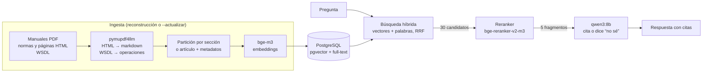

# RArca

Asistente que responde preguntas sobre **facturación electrónica, monotributo y los web services de ARCA** citando
la fuente oficial exacta. Corre completo en una PC con una RX 6650 XT de 8 GB: sin APIs pagas, sin datos que salgan
de la máquina, y con una evaluación que mide cuánto acierta.

> Proyecto técnico, no asesoramiento fiscal: toda respuesta debe verificarse en la fuente citada.

**Corpus: 124 documentos oficiales** (6361 fragmentos, 5539 de versiones vigentes): manuales de 50 web services de ARCA (WSAA, WSFEv1, WSMTXCA,
padrón, WSCDC, carta de porte, liquidaciones, remitos…) y sus WSDL, las RG 4291, 5616 y 5700, y el micrositio de
monotributo. Cuando ARCA publica una revisión de un manual, la anterior queda en el índice marcada como no vigente y
la búsqueda la excluye (por ejemplo, WSFEv1 v4.7 → v4.8 del 1/12/2026).

## Resultados

Medición final sobre las **33 preguntas de reserva**, que no se usaron para ajustar nada:

| Métrica | Total | Facturación (14) | Monotributo (8) | Web services (8) |
|---|---|---|---|---|
| Recuperación@5 (la evidencia llega al modelo) | 76,7% | 57,1% | 100% | 87,5% |
| Exactitud (juez) | 66,7% | 64,3% | 75,0% | 62,5% |
| Fidelidad (lo que afirma está en las fuentes) | 93,1% | 84,6% | 100% | 100% |
| Abstención ante preguntas fuera del corpus | 2/3 | | | |
| Latencia mediana / p95 | 6,0 s / 10,2 s | | | |

La pregunta "fuera del corpus" que respondió (#77, "¿cuál es la mejor obra social?") tenía respuesta en la fuente
("la que mejor se adecúe a tus necesidades", con el listado oficial): fue un error de etiquetado del set, que se dejó
como estaba para no ajustar la evaluación después de ver el resultado. Muestras chicas: en facturación una pregunta
vale 7 puntos. Con el corpus inicial (42 documentos, 24 preguntas de reserva) la medición había dado recuperación
77,3%, exactitud 72,7%, fidelidad 90,5% y abstención 2/2, con latencia de 5,7 s sin escritorio.

Cómo se llegó ahí, una mejora por vez (facturación, 31 preguntas con evidencia):

| Configuración | Recuperación@5 | Exactitud | Fidelidad | Latencia |
|---|---|---|---|---|
| Búsqueda vectorial (bge-m3) | 54,8% | 62,9% | 83,9% | 5,2 s |
| + búsqueda híbrida (full-text + vectores, RRF) | 64,5% | 66,1% | 86,7% | 5,9 s |
| + reranker bge-reranker-v2-m3 en GPU | **74,2%** | **72,6%** | **90,0%** | 7,0 s |

Detalle, variantes descartadas (otro generador, partición fija, reranker en CPU, juez con razonamiento) y el
análisis de ruido entre corridas en [`eval/EXPERIMENTOS.md`](eval/EXPERIMENTOS.md).

## Comparación con una herramienta existente

Sobre el **mismo corpus de 124 documentos y las mismas 99 preguntas**, RArca recupera la evidencia en el **80,8%** de
los casos contra **50,5%** de [mcp-arca-afip](https://github.com/faeralan/mcp-arca-afip), un servidor MCP open source
con búsqueda híbrida (BM25 + e5-small + RRF) cuyo corpus de 51 web services se tomó como base para ampliar el de
RArca. En las 30 preguntas de reserva: **76,7% contra 40,0%**; en las de web services, su terreno: 85,2% contra 40,7%.

| Corpus compartido | RArca | mcp-arca-afip |
|---|---|---|
| Inicial (42 documentos, 72 preguntas) | 81,9% | 61,1% |
| Ampliado (124 documentos, 99 preguntas) | 80,8% | 50,5% |

Al ampliar el corpus mcp-arca-afip pierde 10,6 puntos y RArca 1,1. RArca con búsqueda solo vectorial ya lo superaba
en el corpus inicial (72,2%): la mayor parte de la ventaja viene de la extracción con títulos y tablas y de la
partición por sección. A cambio, mcp-arca-afip busca en ~9 ms en CPU y RArca tarda ~1,5 s y necesita una GPU.
Método, parche de robustez aplicado a su ingesta y cómo reproducirlo en
[`eval/COMPARACION_MCP.md`](eval/COMPARACION_MCP.md).

## Arquitectura



| Servicio (Podman) | Qué hace | VRAM |
|---|---|---|
| `ollama` | qwen3:8b genera; bge-m3 calcula embeddings (ROCm) | 6,2 + 0,7 GB |
| `reranker` | bge-reranker-v2-m3 en llama.cpp con Vulkan (Ollama no sirve rerankers) | 0,8 GB |
| `db` | PostgreSQL 17 con pgvector; índice full-text en español | — |
| `api` | FastAPI: `/preguntar`, `/health` e interfaz web | — |

## Decisiones, con el número que las justifica

- **Evidencia textual en vez de URL para medir la recuperación.** Un manual de 121 páginas es una sola URL: medir
  por URL daba acierto casi siempre. Cada pregunta tiene una frase de la fuente y la métrica exige que llegue al
  modelo.
- **pymupdf4llm para los PDF.** Sobre 14 filas de tabla conocidas: pdftotext 10/14, pdfplumber y pymupdf4llm
  14/14 (con correcciones), y solo pymupdf4llm conserva los títulos para partir por sección.
- **Reranker en GPU.** En CPU subía la recuperación a 80,6% pero tardaba 19 s por consulta; en GPU, ~1 s.
  Reordenar menos candidatos para acelerarlo borraba toda la ganancia.
- **qwen3:8b como generador.** Con la misma recuperación, llama3.1:8b sacó 6,5 puntos menos de exactitud y
  respondió una pregunta fuera del corpus en vez de abstenerse.
- **30 candidatos al reranker (40 por método).** Con el corpus ampliado, 20 se quedaban cortos: manuales de
  servicios parecidos (WSFEv1, MTXCA, WSCT, WSBFE) ocupaban la lista. Subirlos llevó el conjunto de ajuste de 76,8% a
  82,6% de recuperación, decidido sin mirar la reserva, a cambio de 0,6 s más.
- **Versiones vigentes en vez de duplicados.** El corpus de mcp-arca-afip tiene dos versiones de varios manuales
  (por ejemplo WSBFEv1 v3.0 y v3.2); RArca indexa ambas pero solo busca en la vigente.
- **Jueces elegidos por coincidencia con etiquetas manuales** sobre 20 respuestas: exactitud con llama3.1:8b
  (85% de coincidencia), fidelidad con qwen3:8b afirmación por afirmación (75%). La fidelidad publicada es por
  eso una cota optimista.

## Limitaciones conocidas

- **Ruido entre corridas.** Con el escritorio abierto, dos corridas idénticas difirieron en 6 de 56 respuestas;
  sin escritorio, las dos corridas finales dieron lo mismo (hipótesis: con la VRAM llena, Ollama pasa capas a la
  CPU y la inferencia deja de ser determinista). Con 31 preguntas de facturación, diferencias menores a ~10
  puntos no son concluyentes.
- **Facturación es lo más difícil (57–67% de recuperación)**: preguntas de procedimiento redactadas en lenguaje
  natural contra tablas técnicas, respuestas repartidas entre fragmentos vecinos, y desde la ampliación cinco
  manuales de factura electrónica con reglas casi idénticas compitiendo por los mismos candidatos.
- **El modelo de 8B a veces completa con datos plausibles** cuando la evidencia no llegó, en vez de decir "no sé".
- **Corpus acotado**: web services, factura electrónica, tres RG y monotributo. Régimen general (IVA, ganancias)
  queda fuera. Las fuentes nuevas que publique ARCA hay que agregarlas a mano (`scripts/descubrir_ws.py` parte de
  la lista de mcp-arca-afip); la actualización semanal solo detecta cambios en las que ya están.
- **VRAM al límite**: los tres modelos ocupan ~7,7 de 8 GB. Con el escritorio abierto, Ollama pasa parte de un
  modelo a la CPU y la latencia empeora 1 a 2 s.

## Cómo correrlo

Requiere Podman con `podman-compose` y una GPU AMD (ROCm para Ollama, Vulkan para el reranker).

```bash
git clone <este repo> && cd RArca
./scripts/preparar.sh          # modelos (~12 GB), contenedores e índice (~20 min la primera vez)
# abrir http://127.0.0.1:8000  (o la IP de Tailscale si se define RARCA_HOST en .env)
```

Otros comandos:

```bash
podman-compose run --rm api python -m app.ingest --actualizar   # reindexa solo lo que cambió en ARCA
uv run python -m eval.evaluar                                    # evaluación completa (conjunto de ajuste)
uv run python -m eval.evaluar --solo-recuperacion                # solo recuperación, en segundos
```

La RX 6650 XT (gfx1032) no tiene soporte oficial de ROCm: el compose la presenta como gfx1030 con
`HSA_OVERRIDE_GFX_VERSION=10.3.0`. Con otra placa AMD, ajustar o quitar esa variable.

## Estructura

```
app/        ingest.py (descarga, partición, embeddings), fuentes_ws.json, busqueda.py, rag.py, main.py, static/
eval/       preguntas.jsonl (110), evaluar.py, validar_juez.py, validacion_juez.md, EXPERIMENTOS.md,
            COMPARACION_MCP.md, mcp/ (artefactos de la comparación)
scripts/    preparar.sh, descubrir_ws.py, extractores.py, comparar_mcp.py
deploy/     servicio y temporizador systemd para la actualización semanal
```
